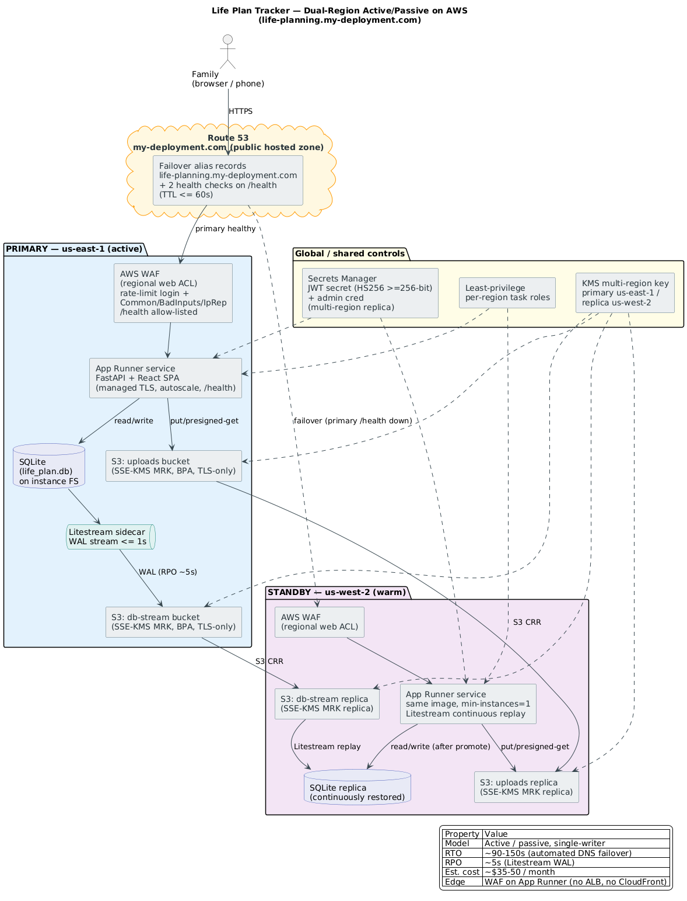

# Life Plan Tracker — AWS Deployment Strategy

Dual-region, active/passive deployment plan for taking the Life Plan Tracker
online securely with the smallest practical footprint. This document is the
output of a three-reviewer adversarial design review ("fellowship of three":
a Minimalist, an Availability Hawk, and a Security Auditor) that iterated to
consensus.

**Target URL:** `https://life-planning.my-deployment.com`
**Status:** design approved; not yet provisioned.

---

## Architecture



*(Diagram source: [`architecture.puml`](architecture.puml). Re-render with the
command in the "Rendering the diagram" section below.)*

---

## DNS requirement — translated

You asked to use **`my-deployment.com`** with a **subpath** for life planning,
e.g. `my-deployment.com/life_planning`. One important clarification drove the
design:

> **DNS cannot route subpaths.** DNS only resolves *hostnames* — everything
> before the first `/`. The `/life_planning` part is an application/proxy
> routing concern, not a DNS one.

There are two ways to deliver what you want:

### Option 1 — Subdomain (recommended, used in this plan)

```
https://life-planning.my-deployment.com
```

- DNS points `life-planning.my-deployment.com` at the App Runner service.
- **No application code changes**, no extra edge layer.
- Keeps `my-deployment.com` free as a hub for future deployments (the domain
  name itself implies you plan to host several things).
- This is the standard, robust approach and is what the rest of this document
  assumes.

### Option 2 — Literal subpath (`/life_planning`)

```
https://my-deployment.com/life_planning
```

- Requires a front-door router (CloudFront with a path-based behavior) **plus**
  telling the app it lives under `/life_planning` (React build `base` +
  FastAPI `root_path`).
- Adds back the CloudFront layer the review deliberately dropped to stay
  minimal, is an app code change, and slightly complicates failover.
- Deferrable: we can add this later without redoing the core design.

**Decision:** ✅ **Option 1 selected — `life-planning.my-deployment.com`.** The
rest of this document assumes it.

---

## Design summary

| Property | Value |
|----------|-------|
| Model | Active / passive, single-writer |
| Primary region | `us-east-1` (active) |
| Standby region | `us-west-2` (warm) |
| Compute | AWS App Runner (one service per region) — no ALB, no CloudFront |
| Failover | Route 53 health-checked DNS failover on `/health` |
| RTO | ~90–150 seconds (automated, no human action) |
| RPO | ~5 seconds (Litestream WAL streaming) |
| Edge security | AWS WAF attached directly to each App Runner service |
| Est. cost | ~$35–50 / month |

### Why this shape

- The app is a **single process** (FastAPI serving the built React SPA on one
  port). App Runner fits a one-container app with managed TLS, autoscaling,
  health checks, and a stable HTTPS endpoint — no load balancer required.
- The app's **only persistent state** is a local SQLite file and a local
  `uploads/` directory. This single-writer, file-based state is the crux of any
  multi-region design and is solved below without a database migration.
- **AWS WAF attaches directly to App Runner** (regional web ACL, GA 2023). This
  removed the need for an ALB or CloudFront to get a WAF in front of the admin
  login — the single biggest footprint/cost saving in the review.

---

## How state is made dual-region (the crux)

The app keeps SQLite — **no migration to Aurora/DynamoDB**. Instead:

1. **SQLite → S3 via Litestream.** A Litestream sidecar streams the SQLite WAL
   to an S3 "db-stream" bucket continuously (sync interval ≤ 1s), giving an
   effective **RPO of ~5 seconds**.
2. **`uploads/` → S3.** User-uploaded images/videos/PDFs move off the container
   filesystem into a private S3 "uploads" bucket. The app stores object keys and
   serves files via short-TTL presigned URLs. **This requires a small code
   change** (see "Required code change" below) and is non-negotiable — stranded
   local files would become broken links after any failover.
3. **S3 Cross-Region Replication (CRR)** copies both buckets from `us-east-1`
   to `us-west-2`.
4. **Warm standby replay.** The standby App Runner service runs Litestream in
   **continuous replay** mode (not restore-on-failover), so its SQLite replica
   is always current and ready to be promoted to writer on failover.

Because the writer is single (SQLite), the design is deliberately **active/
passive**. Active/active was rejected by all three reviewers: it would require
abandoning SQLite and introduces split-brain risk for no benefit at family
traffic levels.

---

## Security controls (secure-by-default, proportionate)

| Area | Control |
|------|---------|
| Default credentials | Eliminate `admin/changeme` before public DNS; refuse to serve if the admin password still equals the seed |
| JWT | Secret moved to Secrets Manager; **HS256, ≥256-bit, short TTL**, rotatable without redeploy (RS256 judged unnecessary for a single-process monolith) |
| Secrets | AWS Secrets Manager with a **`us-west-2` replica** so the standby boots without cross-region calls |
| Edge / login abuse | AWS WAF (regional) on each App Runner service: rate-based rule on the login path + `CommonRuleSet` + `KnownBadInputs` + `IpReputationList`. **`/health` is allow-listed above the rules** so failover health checks are never blocked |
| Transport | App Runner managed TLS (ACM); app-level **HSTS + CSP + security headers**; Secure/HttpOnly/SameSite cookies |
| Data at rest | Both S3 buckets: **SSE-KMS with a KMS multi-region key** (primary `us-east-1`, replica `us-west-2`, same key id/material so the standby decrypts with no cross-region call), Block Public Access ON, TLS-only bucket policy, versioning ON |
| IAM | Least-privilege per-region task roles scoped by ARN; `kms:Decrypt/Encrypt` only on the in-region key; CRR via a scoped service role. **Retire the long-lived `house-user` for workloads** |

### The one landmine the review caught

A **single-region KMS CMK** would make the `us-west-2` standby unable to
decrypt the replicated database/uploads/secret during a `us-east-1` outage —
i.e., a standby that boots but can't read its own state. The fix, baked into the
plan, is a **KMS multi-region key**: primary in `us-east-1`, replica in
`us-west-2`, identical key material, key policy valid in both regions.

> **Phase-1 status (live):** the deployed key
> `alias/life-planning` (`...key/5fde3a41-...`) is currently **single-region**
> (`MultiRegion: false`) — correct and sufficient for the single-region phase 1.
> **Before the phase-2 us-west-2 standby, this must be upgraded to a
> multi-region key** (recreate as MRK + re-encrypt existing objects, or add a
> replica with a key rotation). Tracked here and in `.arn-env`.

### Bucket naming convention (security)

The uploads bucket uses a **securely-random hex suffix**
(`life-planning-uploads-<24 hex chars>`) rather than a predictable name like the
account id. This removes a reconnaissance signal (bucket names are globally
visible namespace). The real name is recorded in the git-ignored `.arn-env` and
sourced by every deploy/monitor command (`set -a; . ./.arn-env; set +a`), so no
step hardcodes it.

---

## Required code change (before any cloud work)

Move attachment storage from the local `uploads/` directory to S3:

- `app/backend/routes/events.py` — write uploads to the S3 uploads bucket;
  store the object key in the DB; serve via presigned GET URLs.
- Add a `/health` endpoint (if not already present) returning `200` for the
  Route 53 / WAF health checks.
- Add config for bucket name, region, and KMS key via environment variables
  (sourced from Secrets Manager / SSM at runtime).

This is the only application change the design requires; everything else is
infrastructure.

---

## Rollout sequence

1. **Harden the app locally**: `/health` endpoint, uploads→S3 refactor, pull
   JWT secret + admin cred from env/Secrets Manager, forced admin-password reset
   on first boot. Verify with the existing Playwright suite.
2. **Primary region (`us-east-1`)**: create KMS multi-region key, S3 buckets
   (BPA + SSE-KMS + TLS-only + versioning), Secrets Manager secret, IAM task
   role, App Runner service from the container image, regional WAF web ACL.
3. **Validate primary**: hit the App Runner URL directly, confirm TLS, login,
   uploads round-trip through S3, Litestream streaming to S3.
4. **Standby region (`us-west-2`)**: KMS replica key, replica buckets + CRR,
   Secrets Manager replica, IAM role, App Runner service (min-instances=1,
   continuous Litestream replay), regional WAF.
5. **DNS**: add Route 53 failover alias records for
   `life-planning.my-deployment.com` + two `/health` health checks (30s / 3
   fails, TTL ≤ 60s). Delete the orphan `app.housing-planner.com` ACM
   validation CNAME (unrelated leftover).
6. **Game-day gate** (below) before declaring done.

---

## Failover game-day (release gate)

A scheduled, automated **quarterly game-day** is a hard release gate. It must
verify, with **no human action in the data-plane path**:
- [ ] Forcing a primary `/health` failure triggers automatic DNS failover.
- [ ] Wall-clock **RTO ≤ 5 minutes** to first successful write in the standby.
- [ ] A canary row written in the standby **round-trips back** to the primary
      after recovery, proving bidirectional CRR and **RPO ≤ 60s**.
- [ ] The standby **decrypts** the DB, uploads, and JWT secret using
      `us-west-2` keys with **no manual key/IAM action**.
- [ ] WAF did **not** block the health checker (`/health` allow-list works).

A failed game-day blocks release.

---

## Phase 2 requirement — region-changeover UX indicator

**Requirement (user request):** during a region failover, show the user a
**plain-language message** naming which region is down and which is being
brought up, with a "give it a few minutes" note. **No countdown timer** — the
message simply auto-dismisses when the backend answers again (chosen as the
path of least resistance; a timer can desync from reality and adds nothing).

**Status:** the client-side overlay is **already built** (dormant) in
`app/frontend/src/components/RegionFailoverBanner.jsx`, mounted globally in
`App.jsx`. It polls `/api/health` (30s healthy, 5s once failing), remembers the
last-known-good region, and after 3 consecutive failures shows a plain-language
overlay: "<down region> is having trouble, bringing the service up in <backup
region>, give it a few minutes." It auto-dismisses when health returns. In
phase 1 (single region) it effectively never fires, since a brief blip clears
on the next poll and there is no second region to name.

**Design note (why client-side):** during DNS failover the primary app itself
is unreachable, so the message must live in the already-loaded SPA (it keeps
running in the browser while DNS re-points). An always-on edge status page
(static S3/CloudFront) remains a future option if the message needs to survive
a full page refresh mid-outage.

---

## Cost breakdown (rough, monthly)

| Item | Est. |
|------|------|
| App Runner — primary (active) | $10–18 |
| App Runner — standby (warm, min-1) | $5–7 |
| AWS WAF — 2 regional web ACLs + rules | $12–16 |
| Route 53 — hosted zone + 2 health checks | ~$4 |
| S3 + CRR + Litestream storage/requests | $2–5 |
| Secrets Manager (+ replica) | ~$2–3 |
| KMS multi-region key | ~$1–2 |
| ACM TLS | Free |
| **Total** | **~$35–50 / mo** |

For comparison, the rejected ECS Fargate + 2 ALB design added ~$60–75/mo on
top for no availability gain at this traffic level.

---

## Explicitly rejected (and why)

| Rejected | Why |
|----------|-----|
| Active/active | SQLite is single-writer; split-brain risk, no benefit at family scale |
| Aurora Global / DynamoDB global tables | Full data-layer rewrite + ~$200–300/mo for a trivial-write app |
| ECS Fargate + 2 regional ALBs | ~$36/mo/ALB tax; App Runner already does TLS/health/autoscale |
| CloudFront + global WAF | Unneeded once WAF attaches directly to App Runner; adds a failure domain and conflicts with clean Route 53 failover |
| Cognito | Scope creep; WAF rate-limit + fixed creds + short tokens is proportionate |
| RS256 JWT | Single issuer/verifier monolith; asymmetric keys buy nothing here |
| Long-lived `house-user` for workloads | Plaintext-credential risk; use per-region task roles |

---

## Rendering the diagram

The diagram PNG is generated from [`architecture.puml`](architecture.puml) with
PlantUML (Java 11+, Graphviz):

```bash
cd deploy
PLANTUML_LIMIT_SIZE=16384 JAVA_TOOL_OPTIONS="-Djava.awt.headless=true" \
  java -jar ~/.local/lib/plantuml.jar -tpng architecture.puml
```

---

## Open decisions for you

1. **DNS style**: ✅ **DECIDED — Option 1: `life-planning.my-deployment.com`
   subdomain.** (The literal `/life_planning` subpath was declined; it can be
   added later via CloudFront if ever needed.)
2. **Scope**: full dual-region now (~$35–50/mo) vs. single-region first with the
   same hardening (~$10–20/mo), extended to the standby region later.
3. **Admin password**: pick the new admin credential to set during hardening.
