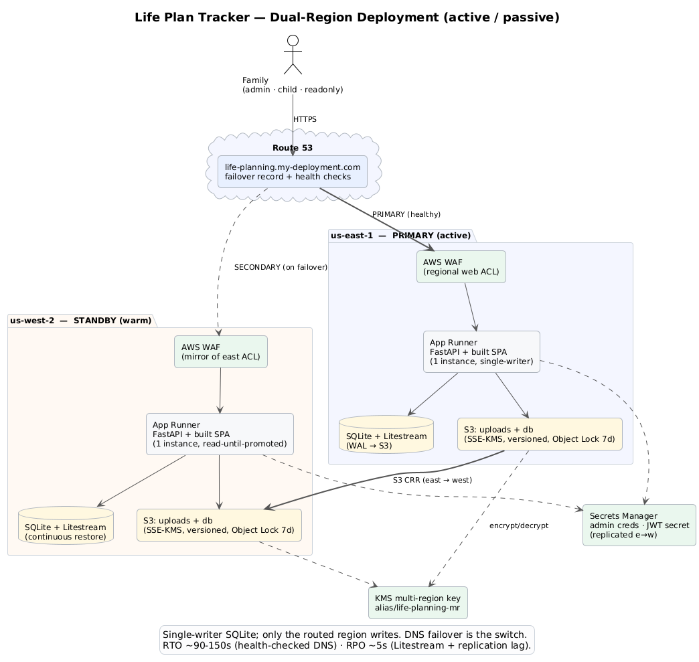
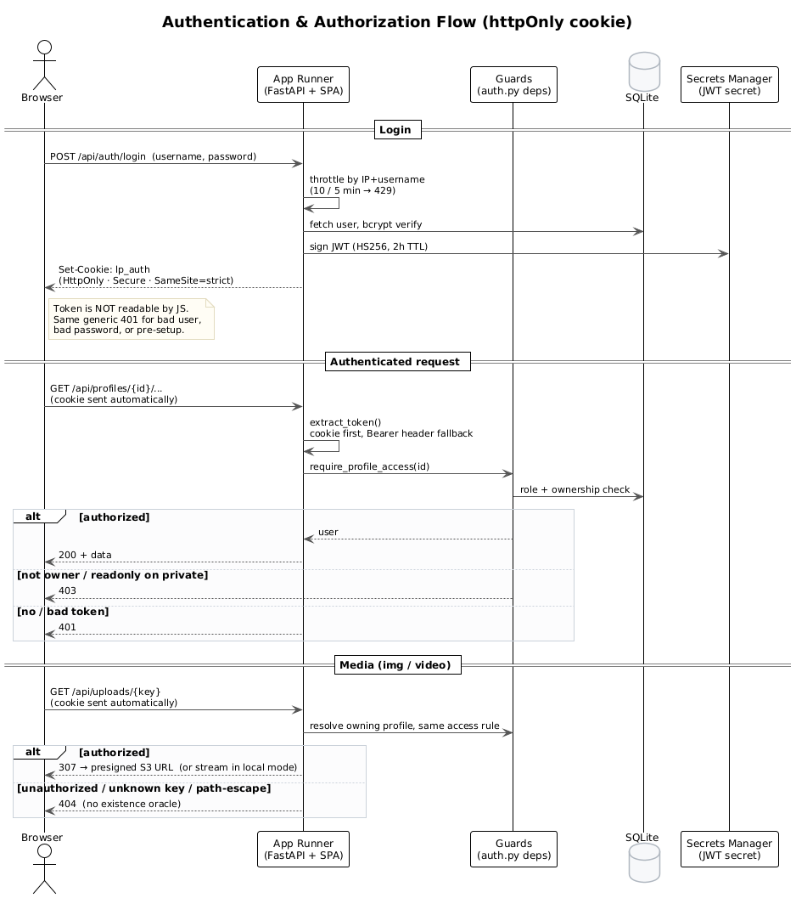
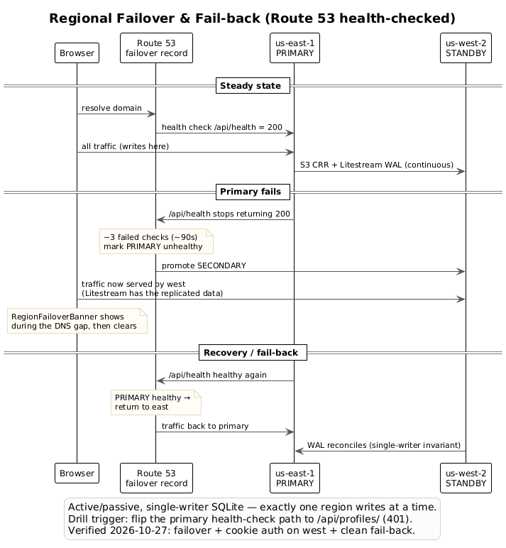

# Life Plan Tracker — Security Review

_Assembled 2026-10-27 from the repository, commit history, and deployment state.
This is the baseline document for a 3-agent security re-review. Every claim below
is grounded in code/config in this repo; file references are given so reviewers
can verify._

---

## 1. System summary

- **What:** a private, invite-only family web app tracking a child's lifetime
  development (pillars, family economy/bounties, discernment journals, early
  childhood "Child Development", life maps).
- **Stack:** FastAPI (Python 3.12) + React/Vite SPA, SQLite (`life_plan.db`),
  attachments in S3 (AWS) or local disk (dev). Single Docker image serves the
  built SPA + API same-origin.
- **Deploy:** AWS App Runner, dual-region (us-east-1 primary / us-west-2 warm
  standby), Route 53 failover, behind AWS WAF, custom domain with managed TLS.
- **Users/roles:** `admin` (parents), `child` (the child, scoped to own
  profile), `readonly` (extended family, view-only). ~7 real accounts.
- **Sensitive assets:** children's PII (name, DOB, **photos/videos**), the
  **behavior-incident log**, **private discernment journals**, **financial
  totals**, and account credentials/email.

### Architecture

Deployment topology (dual-region, active/passive):

Authentication & authorization request flow (httpOnly cookie, cookie-first with
Bearer-header fallback):

Regional failover & fail-back (Route 53 health-checked DNS):

---

## 2. Authentication

- **Password hashing:** bcrypt via `passlib`/`bcrypt` (`auth.hash_password` /
  `verify_password`). No plaintext passwords stored or emailed.
- **Sessions:** JWT (HS256), signing key from Secrets Manager in AWS
  (`config.get_jwt_secret`; `auth.py:15-17`). **TTL 2 hours**
  (`ACCESS_TOKEN_EXPIRE_MINUTES = 120`) — short-lived by design.
- **Account provisioning:** admins never set/receive a password. New users get a
  **one-time, 72h setup link** (hashed token stored, not the raw token);
  `must_change_password` blocks login until setup completes.
- **Default-credential guard:** in AWS mode the app **refuses to boot** with the
  `admin`/`changeme` default (`config.get_admin_credentials` raises
  `RuntimeError` if the secret is missing); admin creds are sourced from Secrets
  Manager and re-synced on boot. (Test: `tests/test_auth_hardening.py`.)
- **Token storage (HARDENED 2026-10-27):** the JWT is now carried in an
  **httpOnly, `SameSite=strict`, `Secure` cookie** (`lp_auth`), so it is **not
  readable by JS** — an XSS can no longer exfiltrate it. The backend reads the
  token cookie-first with an `Authorization: Bearer` header fallback (API
  clients + safe rollout). `SameSite=strict` + same-origin API mitigates CSRF;
  the strict CSP (§5) remains a second barrier. A `no-danger` pre-commit hook
  blocks any future HTML-injection sink in the SPA. (Supersedes the former
  localStorage risk.)

---

## 3. Authorization / access control (the core of this app's security)

Role + per-profile guards in `auth.py`, applied as FastAPI dependencies
(router-level where possible). Guard matrix:

| Guard | Admits | Rejects | Used for |
|---|---|---|---|
| `require_admin` | admin | child, readonly | user mgmt, profile create/delete, backups, lessons |
| `require_admin_or_child` | admin, child | readonly | all write operations (readonly is view-only) |
| `require_profile_access` | admin, readonly, **owning** child | **non-owning child**, ungranted others | router-level on every `/profiles/{id}/...` route |
| `require_private_profile_access` | admin, **owning** child | readonly, non-owning child | behavior log, journals, financial totals, CD worries |
| `require_private_access` | admin, child | readonly | (legacy; superseded by the profile-aware variant) |

**Key invariants, each backed by a fix + regression test:**

1. **Readonly is view-only.** All writes depend on `require_admin_or_child`;
   readonly gets 403. Frontend also hides CRUD controls + shows a role banner
   and a 403 toast (defense-in-depth, not the boundary). Regression:
   `tests/test_readonly_enforcement.py` enumerates every mutating route and
   asserts a readonly-blocking guard. (Commits `064464f`, `75d3a04`.)

2. **Child cannot self-deal.** Behavior-incident create/delete and bounty
   `paid` transitions are admin-only — a child can't score their own behavior or
   pay themselves. (Commit `75d3a04`; `routes/economy.py`.)

3. **Cross-child isolation (FIXED vulnerability).** Profile-scoped sub-resource
   routes previously checked only *role*, not *ownership* — a child could read
   another child's data by changing the URL id (verified exploitable, then
   fixed). `require_profile_access` is now a **router-level dependency on all 7
   profile-scoped routers** (pillars, economy, funds, lessons, discernment,
   discernments, events). Regression tests assert a non-owning child + readonly
   get 403. (Commit `a4db463`.)

4. **Private-by-design data.** Behavior log, discernment journals, and aggregate
   financial totals use `require_private_profile_access` (admin + owning child
   only; **readonly excluded**). The discernment journal is further an
   author-scoped diary: a child's reflections are invisible to admin; admin sees
   only admin-authored notes. `/eligibility` returns tier-only for readonly (no
   per-trait behavior breakdown). (Commits `f6f5480`, `14a49f9`, `6edbe55`.)

5. **Public demo isolation.** `/demo` + `/api/demo/*` serve 100% static
   in-memory fake data and never touch the DB, so no real profile can leak via
   the demo. (`routes/demo.py`.)

**Known / accepted:** admin and readonly have **household-wide** access to all
profiles (single-family model, owner-accepted). `ProfileAccess`-based per-profile
scoping exists for "other" roles and is the hook to tighten this before any
non-family user is added. Child Development objectives + accomplishment photos
are intentionally **family-readable**; only the "worries" note is parent/child
private.

---

## 4. Data protection

- **Encryption at rest:** S3 uploads + the SQLite DB stream (Litestream) are
  SSE-KMS encrypted with a customer-managed multi-region KMS key
  (`alias/life-planning-mr`). Uploads bucket: Block Public Access, versioning,
  SSE-KMS default, **TLS-only bucket policy** (non-HTTPS denied).
  (`deploy/SECURITY_GATES.md` steps 2-3.)
- **Encryption in transit:** HTTPS end-to-end via App Runner managed TLS on the
  custom domain; HSTS header set (§5).
- **Attachment serving (AUTHORIZED):** `/api/uploads/{key}` resolves the file's
  owning profile and applies the same per-profile access rule as all other
  profile data; unauthorized / unknown-key / path-escape requests return **404**
  (no existence oracle). Auth is taken from the httpOnly cookie first (so
  ``/`<video>` tags work without JS) with a `?token=` query fallback. Only
  after the access check does it mint a short-lived SigV4 presigned S3 URL (307)
  or stream locally (forced attachment disposition + nosniff). (Commits
  `a3a5806`, blob-authz 2026-10-27; `tests/test_upload_authz.py`.)
- **Secrets:** admin creds + JWT secret in Secrets Manager (replicated to the
  standby region); never in the repo. `.arn-env` (git-ignored) holds resource
  IDs only. Source reference PDFs live in a git-ignored `reference/` folder.
- **Backup / delete:** profile **archive** (zip of per-domain JSON + blobs) with
  a **signed one-time token handshake** required before a **full-clean delete**
  (removes DB rows *and* storage blobs). Restore preserves IDs, fails on
  conflict. (Commit `e5ea0b9`; `routes/archive.py`;
  `tests/test_delete_profile.py` round-trip.)

---

## 5. Network / transport / headers

- **AWS WAF** regional web ACL attached to the service; allow-lists `/api/health`
  and the SPA; blocks unexpected paths. (`deploy/SECURITY_GATES.md` step 6.)
- **Security headers** (middleware, `main.py`): `X-Content-Type-Options: nosniff`,
  `X-Frame-Options: DENY`, `Referrer-Policy: no-referrer`, **HSTS**
  (1 year + subdomains), and a **Content-Security-Policy** (`default-src 'self'`,
  `object-src 'none'`, `frame-ancestors 'none'`, `base-uri 'self'`). With the
  JWT now in an httpOnly cookie, CSP is defense-in-depth against script
  injection rather than the sole barrier to token theft.
- **CORS:** in AWS mode restricted to the app's own origin with
  `allow_credentials=False`; wildcard only in local dev.
- **API docs disabled in production:** `docs_url`/`redoc_url`/`openapi_url` are
  `None` when `IS_AWS` (no public schema surface). (Commit `4e0b513`.)

---

## 6. Email security (SES)

- Sends only from the **DKIM-aligned domain** `no-reply@life-planning.my-deployment.com`
  (Easy DKIM + custom MAIL FROM + `_dmarc` record, both regions). Fixed a real
  DMARC-fail bounce caused by the earlier `@proton.me` sender. (Commits `0ee46c7`,
  `7ef2d5e`.) Invitations carry no password and a 72h expiry.
- The web app never sends email — only the local `provision_user.py` CLI does, so
  there is no public email-send surface to abuse.

---

## 7. Supply chain / SDLC

- **Pre-commit security gate:** `detect-private-key`, **gitleaks**, **bandit**
  (Python SAST), **pip-audit** (Python CVEs), **npm audit** (frontend prod deps,
  outage-tolerant), **hadolint** (Dockerfile), plus ruff/mypy.
- **Tests:** backend suite incl. dedicated security tests
  (`test_auth_hardening`, `test_readonly_enforcement`, `test_child_development`,
  `test_delete_profile`, `test_storage`); Playwright a11y + walkthrough e2e.
- **Images:** Docker build excludes tests/CLI/.env via `.dockerignore`; runtime
  deps pinned; runtime venv mirrors the image.
- **Least privilege:** App Runner instance role grants only read of the two
  secrets, the uploads bucket, the one KMS key, and its own logs.

---

## 8. Known risks / open items (for the review to weigh)

| # | Item | Severity (self-assessed) | Status |
|---|---|---|---|
| R1 | JWT token theft via XSS | Low (was Medium) | **RESOLVED** — JWT moved to an httpOnly `SameSite=strict` `Secure` cookie (not JS-readable); `no-danger` lint blocks HTML sinks |
| R2 | Admin + readonly see ALL profiles (no per-profile scoping) | Low (single family) | Accepted; `ProfileAccess` path exists for future non-family users |
| R3 | `require_private_access` (legacy, role-only) still defined | Low | Superseded by profile-aware guard; consider removing to avoid misuse |
| R4 | Archive/restore round-trip for Child Development `*_private` rows + photos | Low | Generic path covers it; **add an explicit round-trip assertion** |
| R5 | `child` role can write (claim bounties, edit own milestones) | Low (by design) | Intended; worth confirming the child account's blast radius |
| R6 | Lessons responses are parent-visible (not child-private) | Low | Intentional (future LLM eval); documented decision |
| R7 | Uploaded blobs orphaned only if delete runs without archive token | Low | Full-clean delete removes blobs; archive handshake enforced |

---

## 9. What this review should scrutinize (handoff to the 3-agent panel)

1. **Access-control correctness** — are the five guards applied to *every*
   sensitive route, with no gap (esp. any new Child Development routes)? Is the
   cross-child fix complete across all 7 routers + the archive/demo/CD routes?
2. **Token/XSS posture** — is CSP actually tight enough given `localStorage`
   JWT + user-uploaded images/`unsafe-inline` styles? Is R1 worth fixing now?
3. **Data-at-rest/secrets/IAM** — least-privilege role scope, KMS key policy,
   secret rotation story, and whether anything sensitive can reach logs.
4. **Tenant isolation & privacy invariants** — can any role (esp. readonly or a
   second child) reach another child's behavior log / journals / financial
   totals / photos by any route, parameter, or the archive/restore path?

---

## 10. Re-review results (3-agent panel, 2026-10-27) + remediation

The panel (access-control, appsec/web, cloud/infra) ran against this doc + live
code. Summary of findings and what was done.

### Fixed in code (this pass) — all test-covered, additive, reversible
- **CRITICAL — unauthenticated blob access (the real one).** `/api/uploads/{key}`
  served any attachment/avatar with **zero auth** and (in AWS) minted a presigned
  URL for anyone — a readonly grandparent or a second child could fetch another
  child's photos by filename. **Fixed:** `serve_upload` now requires a valid JWT
  (via `?token=` since `` tags can't send headers), resolves the file's
  owning profile, and applies the same per-profile access rule; unknown/bad/
  unauthorized/path-escape all return **404** (no oracle). Local serving now
  forces `Content-Disposition: attachment` + `application/octet-stream` so a
  malicious HTML/SVG upload can't execute in the app origin. Frontend fetches via
  a new `uploadUrl()` helper that appends the token. Tests:
  `tests/test_upload_authz.py` (7).
- **HIGH — `/restore` path traversal + blob overwrite.** A crafted archive could
  write `uploads/../x` (local path escape) or overwrite another profile's live
  blob. **Fixed:** reject upload keys containing `/`, `\`, or `..` (400) and
  refuse to overwrite an existing stored key (409). Tests in
  `tests/test_delete_profile.py`.
- **LOW/infra-code — `/api/health` info leak.** The unauthenticated health route
  echoed the uploads bucket name + secrets source. **Fixed:** added
  `config.public_summary()` (mode + region only) for the public route; the
  verbose `summary()` is now logging-only.

### Confirmed SAFE by the panel (no change needed)
- **XSS / crown-jewel path is clean** — `MiniMarkdown` and all rendering go
  through React auto-escaping; **no `dangerouslySetInnerHTML`/innerHTML anywhere**.
  The `localStorage` JWT risk stays gated behind "never add an HTML sink."
- **JWT alg handling safe** — `decode(..., algorithms=["HS256"])` pins the alg
  (no `alg:none`/confusion).
- **Router-level `require_profile_access`** does run on every included route, so
  the bare-`get_current_user` GETs under those routers are still profile-scoped.
- **`profiles` GET `/{id}`** correctly 404s a child on a non-owned profile.
- **Archive token** is not forgeable (HS256, server secret, profile-bound).

### Deferred — documented, NOT changed while unattended (owner decision)
_Update 2026-10-27 (second pass, owner pre-approved): most of these are now DONE
in code; only the cookie migration remains deferred (deliberately)._
- ✅ **Single-use / replay hardening of the archive token.** Token TTL cut 30→10
  min and now **bound to the acting user id** (`uid` claim) — a leaked token is
  short-lived and unusable by a different account. (Full single-use `jti` state
  still skipped — needs cross-region storage; the binding + short TTL cover the
  practical risk.) Tests in `tests/test_delete_profile.py`.
- ✅ **Login user-enumeration.** The pre-setup case now returns the SAME generic
  401 as a wrong password (no distinguishing 403), with a generic setup hint
  that doesn't confirm a specific account. (`routes/users.py`.)
- ✅ **Login rate limiting (in-app).** Process-local sliding-window throttle on
  `/api/auth/login` (10 attempts / 5 min per IP+username → 429). Effective given
  the single-instance App Runner pin; complements (not replaces) a WAF rate rule.
  Tests: `tests/test_login_throttle.py`.
- ✅ **`no-danger` guardrail.** New pre-commit hook fails the build if
  `dangerouslySetInnerHTML`/`innerHTML`/`insertAdjacentHTML`/`document.write`
  is ever introduced in the SPA — permanently gates the localStorage-JWT risk.
- ⏸️ **R1 localStorage JWT → httpOnly cookie + CSRF — STILL DEFERRED (on purpose).**
  This is a high-blast-radius auth rewrite (cookie set/read, CSRF tokens on all
  state-changing routes, and it interacts with the new blob `?token=` scheme); a
  mistake could lock out all users. The appsec agent explicitly advised against a
  reactive migration, and residual risk is low now (clean XSS path + no-danger
  lint + 2h TTL + tight CSP). **To be done WITH the owner present** so login /
  logout / image-loading can be verified end-to-end before it goes live.

### Owner-required infra checklist (NOT touched while unattended)
_Update 2026-10-27 — read-only verification done; one real finding surfaced._
1. **WAF — ✅ FIXED (2026-10-27, owner present).** The us-west-2 standby now has
   its own `life-planning-waf` web ACL (ARN in `.arn-env` as `WAF_ACL_ARN_WEST`),
   created as a verbatim mirror of the east ACL (all 6 rules incl. the
   LoginRateLimit rate-based rule) and **associated** with the west App Runner
   service. Verified live: west behaves identically to east — `/api/health`
   allowed (AllowHealthCheck prio 0), `/` and `/api/profiles` on the default host
   return 403 (BlockDefaultAppRunnerHost). Failover no longer bypasses WAF.
2. **KMS — ✅ VERIFIED multi-region.** `alias/life-planning-mr` →
   `mrk-4e4cf93c38474f2d8bb7e294180eb6f0`, MultiRegion=true, Enabled. Still
   confirm the west replica key + that west can decrypt on failover, and the key
   policy is decrypt-to-role-only / no wildcards.
3. **Secrets** — establish rotation for admin + JWT secrets (per-process
   `lru_cache` ⇒ takes effect on redeploy); CloudTrail alert on `GetSecretValue`
   by any non-instance principal. (Not done unattended — rotation invalidates
   live tokens.)
4. **IAM** — instance-role S3/KMS scoped (no `*`); `house-user` MFA + stale-key
   rotation; root MFA/no-root-keys; CloudTrail multi-region on. (Not unattended —
   lockout risk.)
5. **CloudWatch** — log-group retention + KMS encryption; confirm uvicorn access
   logs don't capture query-string PII (headers/bodies not logged by default).
6. **S3/DR** — confirm Litestream restore window; ensure the least-priv role
   cannot delete object versions / change versioning (consider Object Lock).
   (Not unattended — a wrong deny can block recovery.)
7. **Budgets — ✅ already in place** (`life-planning-monthly`, $70/mo cap). A
   billing *alarm* with SNS notification is the only add still worth doing (left
   for owner since it touches SNS subscriptions).

---

## 11. Re-review results (3-agent panel #2, 2026-10-27) — NEW vectors

A second panel (server-side app-logic · web/HTTP-layer · cloud/infra) hunted
vectors **distinct** from §10. All findings below were verified in code before
acting.

### Fixed in code (test-covered, additive) — `tests/test_economy_integrity.py`, `tests/test_csrf_origin.py`
- **CRITICAL — child could mint money via bounty-PATCH mass-assignment.**
  `routes/economy.py update_bounty` did a blind `setattr` loop over
  `BountyUpdate`; the only role gate was `status == "paid"`. A **child** (allowed
  by `require_admin_or_child`) could PATCH their own bounty with
  `reward_amount` / `times_completed` / `streak_count` / `decay_divisor` and
  inflate their own earnings (the earnings summary is derived from exactly these
  fields). **Fixed:** non-admins may now change **only** `status`, and only to
  `claimed`/`complete`; any other field → 403.
- **HIGH — IDOR on bounty logs.** `list_bounty_logs` filtered only on the global
  `bounty_id`, not the path's `profile_id` (unlike create/delete). A household
  `readonly` viewer could read **any** child's bounty submission notes by
  enumerating ids. **Fixed:** scope the bounty to `profile_id` first (404 if
  mismatch), matching the other handlers.
- **HIGH — CSRF reintroduced by the cookie migration.** With the JWT now an
  ambient cookie, `SameSite=strict` was the **only** CSRF control (no server-side
  check). **Fixed:** added a server-side **Origin allow-list check** for
  `POST/PUT/PATCH/DELETE` in `main.py` (cross-origin → 403; same-origin and
  header-less API clients pass). Defense-in-depth alongside SameSite.
- **Hardening (same middleware):** added `Permissions-Policy`,
  `Cross-Origin-Opener-Policy: same-origin`, and `Cache-Control: no-store` on
  all `/api/*` responses (child PII/financials were cacheable); corrected the
  stale "JWT in localStorage" CSP comment.

### Deferred items — ADDRESSED 2026-10-27 (pass 2b)
_Owner approved working through the deferred list. Status below._
- ✅ **Numeric validation.** Constrained-int aliases in `schemas.py`
  (`Cents`/`Count`/`Divisor ge=2`/`Score1to5`) applied to bounty, wishlist, and
  behavior schemas; `funds.TransactionCreate.amount` is now `gt=0` (a negative
  no longer inflates a fund), `FundCreate.starting_balance ge=0`, `BudgetUpdate`
  caps `ge=0`. Tests: `tests/test_hardening_pass2.py`.
- ✅ **Upload / body DoS.** New request-body-size cap in the `main.py` middleware
  (1 MB JSON / 50 MB upload routes, via Content-Length); `upload_attachments`
  caps file count (20) + per-file size (25 MB) and null-checks `content_type`;
  `restore` enforces a cumulative decompressed-size cap (500 MB) + per-entry
  compression-ratio check (zip-bomb defense).
- ✅ **Admin reseed-on-boot clobber.** `seed_admin` no longer overwrites an
  existing admin's password on every boot — it seeds only if absent. Rolling a
  rotated secret onto the account is now an explicit, auditable opt-in
  (`ADMIN_FORCE_SYNC=1` for one deploy), eliminating the silent revert + the
  cross-region mid-rotation divergence.
- ✅ **JWT-secret rotation key-skew.** `auth.decode_token` now verifies against
  the current secret **plus an optional previous** one
  (`config.get_jwt_decode_secrets`; previous supplied via the secret JSON
  `previous` field or `SECRET_KEY_PREVIOUS`). A rotation (or a brief
  cross-region secret mismatch at failover) no longer rejects valid cookies /
  forces mass re-login. Signing still uses the current secret only. Tests:
  `tests/test_hardening_pass2.py`.
- ⏸️ **Budget cap derived from mutable rows (append-only ledger).** NOT done —
  it's a data-model change (a payout-ledger table + migration). The C1 fix
  already stops a child from forging the inputs; the remaining issue is an admin
  over-paying a repeatable bounty past a cap. Deferred to a dedicated pass.
- ⏸️ **Dual-region fail-back data loss (infra).** Root cause verified: east DB
  bucket CRR → west, **west bucket has NO replication back** (confirmed via
  `get-bucket-replication` → NotFound). Bidirectional CRR is NOT a safe fix
  (two Litestream writers → WAL corruption). Shipped a **gated fail-back runbook
  + `deploy/failover_control.sh`** (hold-east / reconcile-to-east / release-east
  with typed confirmations; reconcile does an `s3 sync` of west's whole
  Litestream generation tree into east). Documented in `PHASE2_FAILOVER.md`;
  the drill's "no divergence" claim downgraded to UNVERIFIED. **Still OPEN for
  owner:** whether to make fail-back *permanently* manual (a live Route 53
  change — left for explicit go-ahead).
- ⏸️ **WAF body-rule Count overrides scoped to upload path (infra).** The
  `SizeRestrictions_BODY`/`CrossSiteScripting_BODY` → Count overrides are still
  web-ACL-wide; re-scoping them to the upload routes is an owner-side WAF edit.
  (App-layer now has its own body-size cap, reducing the urgency.)
- ⏸️ **`?token=` blob fallback + login token-in-body.** Left as-is pending owner
  call (low; the SPA no longer uses either path).

---

## 12. Re-review results (10-agent panel, 2026-10-31) — new vectors + confirmations

A 10-agent review: **5 adversarial** agents (auth/session · authz/IDOR · web/injection/
upload · cloud/IAM/secrets · supply-chain/business-logic) + **5 research/confirmation**
agents that independently verified the top findings against live code, the live AWS
account (read-only), React's source, and external advisories. Every item below was
spot-checked directly before recording; confidence is noted.

### NEW exploitable findings (verified)

- **HIGH — Supply chain: image runs as ROOT + unverified Litestream binary.**
  `Dockerfile:32` `ADD https://.../litestream-...-linux-amd64.tar.gz` with **no
  checksum/signature**, extracted into `/usr/local/bin`; the runtime stage has **no
  `USER` directive** so uvicorn runs as **uid 0** carrying the App Runner instance
  role (Secrets + S3). A tampered/retagged release = root RCE with AWS creds.
  *Verified: Dockerfile read directly (no USER; ADD present).* Fix: pin + verify a
  SHA256 before extract; add a non-root `USER`.

- **HIGH — Business logic: a CHILD can self-approve/complete their own wishlist
  item.** `routes/economy.py:870 update_wishlist_item` is `Depends(require_admin_or_child)`
  then a blind `setattr` loop (`:884-885`) with no role/field whitelist, and
  `WishlistUpdate.status` is a free string. A child can PATCH their own item to
  `status=approved`/`purchased` (parent-approval bypass) and lower `cost_cents`.
  This is the exact pattern we already fixed on the bounty handler, missed here.
  *Verified directly in code + confirmation agent.* Fix: mirror the bounty
  field-whitelist (non-admins may set only title/description/url/priority; forbid
  status + cost_cents) and make `status` an enum.

- **HIGH (infra, drift) — WAF managed rules disabled in BOTH regions.**
  `SizeRestrictions_BODY` and `CrossSiteScripting_BODY` are set to **Count** (non-
  blocking) in the east AND west web ACLs. *Live-verified via `wafv2 get-web-acl`
  (byte-identical overrides both regions).* XSS-in-body + oversized-body managed
  protections don't block (app CSP + the in-app body-size cap are the only backstop).
  Fix: remove the overrides (restore Block), or scope them to the upload routes only.

- **HIGH (infra) — Instance role can DELETE/overwrite the DR backups; no Object
  Lock.** The App Runner instance role inline policy grants `s3:DeleteObject` on BOTH
  Litestream DB buckets (east + west); `s3api get-object-lock-configuration` →
  `ObjectLockConfigurationNotFoundError` on both (versioning on, 60-day noncurrent
  expiry). *Live-verified.* A compromised instance can purge/overwrite disaster-
  recovery data. Fix: drop `s3:DeleteObject` on the DB buckets (Litestream needs only
  Get/Put/List); enable S3 Object Lock on both.

- **MEDIUM — Stateless JWT cannot be revoked + credential-leak channels.** Logout
  only clears the cookie; no `jti`/`token_version`/denylist, so a captured token/
  cookie is valid the full 2h TTL with no kill switch; there's no self-service
  password change. Leak channels: the `?token=` blob URL (logs/history) and the JWT
  still returned in the **login JSON body** (`routes/users.py` — SPA ignores it).
  *All four sub-claims verified.* Rated **MEDIUM for this single-family app** (httpOnly
  + SameSite=strict + Secure + CSRF-Origin + CSP cap real-world capture). Fix:
  `token_version` claim checked in `get_current_user` (instant revoke on logout/pw-
  change); drop the body token; drop the `?token=` fallback (cookie already works for
  ``).

- **MEDIUM — Supply chain: `python-jose==3.4.0` (unmaintained; standing advisories).**
  Only HS256 is used and `algorithms=["HS256"]` is pinned everywhere, so alg-confusion
  exposure is low, but the lib is stale (pre-commit already *ignores* `PYSEC-2026-4298`
  et al). *Specific CVE numbers NOT independently confirmed — treat as maintenance/
  known-advisory risk, not a verified CVE.* Fix: migrate to **PyJWT** (low-risk, HS256-
  only), which also clears the stale ecdsa/pyasn1 transitive advisories.

- **MEDIUM — No CI enforcement + unguarded `:latest` auto-deploy to prod.** All gating
  is local pre-commit (bypassable via `--no-verify`); no `.github/workflows`;
  `build_push.sh` pushes `:latest` which auto-rolls both regions with no test/approval
  gate. *Verified: no `.github/` dir.* Fix: server-side CI (re-run lint/sast/audits +
  tests + image scan, block on fail) and an immutable-tag + explicit-promote deploy.

- **MEDIUM — No rate limit on expensive endpoints.** `/archive` (child-callable; builds
  the whole-profile ZIP in memory), `/restore`, `/reseed`, `/backup` have no throttle →
  cheap DoS on the single instance. Fix: throttle these + stream the archive to a temp
  file instead of RAM.

### LOWER-severity / hardening (verified)

- **LOW — Open-redirect/phishing (NOT XSS) via unvalidated `url` fields.** Wishlist
  `url` (child-settable) + lesson `url` (admin) are free strings rendered into `href`.
  *Confirmation agent verified React 18.3.1's `sanitizeURL` neutralizes `javascript:`
  and the CSP blocks inline script — so the earlier "stored XSS" framing is REFUTED;*
  residual risk is a child planting an external phishing link a parent clicks
  (`rel=noopener` already set). Fix: http(s)-only scheme allow-list (server + client).
- **LOW — Residual grandchild IDOR (consistency-only).** `delete_transaction`
  (funds), `delete_response` (lessons), `delete_bounty_log` (economy) scope to the
  immediate parent id but don't re-join parent→`profile_id` like their siblings.
  *Confirmation agent: admin-only reach in a single-child household (no privilege
  gained); degrades to a child-triggerable cross-profile delete of low-value rows only
  in a multi-profile setup.* Fix: add the parent→profile_id join (match siblings).
- **MEDIUM (infra) — East secrets on the AWS-managed key, west replicas on the
  customer MRK.** *Live-verified (`KmsKeyId` null on east, MRK on west).* Fix:
  re-encrypt the two east secrets with the east MRK for consistent CMK control.
- **MEDIUM (infra) — No rotation** on admin creds or JWT secret (both regions); the
  JWT dual-verify (current+previous) support already exists to make rotation low-
  friction.
- **LOW — ECR tag mutability MUTABLE** (scan-on-push on, not public). Fix: IMMUTABLE +
  deploy by digest.
- **LOW — CloudWatch log groups: no retention + not CMK-encrypted;** archive-delete
  token passed as `?archive_token=` query (can land in access logs). Fix: set
  retention + MRK encryption; move the token to a header/body.
- **LOW — bcrypt 72-byte truncation** not guarded (long passphrases silently truncated).
- **LOW — Account id + secret ARNs committed** in `.env.example` + deploy docs
  (`.arn-env` itself correctly git-ignored). Identifiers, not secrets. Fix: scrub to
  placeholders.
- **LOW — CSP hardening:** add explicit `script-src 'self'`; tighten `img-src`/
  `media-src` off blanket `https:`; enforce body-size even when Content-Length absent;
  add a path-containment guard on the SPA catch-all.

### Confirmed CLEAN by the panel (no action)
No new SQL/ORM injection (all parameterized); no CRLF/header injection (static
Content-Disposition); markdown renderer + `original_name` are React-escaped; no SSRF
in request paths; role is re-checked from the DB (JWT claim not trusted for authz);
setup-token entropy/hashing/single-use/expiry correct; mass-assignment on CREATE can't
inject protected columns; `/demo` is static (no DB); S3 posture strong (BPA, SSE-KMS,
TLS-only, versioning); CRR role tightly scoped; no `Action:*`/`Resource:*` in app roles.

### TODO — prioritized remediation list (output of this review)

**P1 — exploitable now / highest blast radius**
- [x] **TODO-1 (HIGH):** Wishlist self-approval — add non-admin field whitelist to
  `update_wishlist_item` (forbid `status`/`cost_cents`) + make `WishlistUpdate.status`
  an enum. Test like the bounty case. *(app code, test-covered, safe)*
- [x] **TODO-2 (HIGH):** Dockerfile — SHA256-verify the Litestream download before
  extract; add a non-root `USER`. *(build; verify container still boots + Litestream
  restore works)*
- [x] **TODO-3 (HIGH, infra):** DONE 2026-10-31 (both regions). **CrossSiteScripting_BODY
  restored to Block** (the real XSS-body gap). **SizeRestrictions_BODY kept as Count**
  on purpose — its default Block caps bodies at 8KB which would break multipart
  photo/attachment uploads; the app enforces its own body-size caps (1MB JSON /
  50MB upload) instead. Verified live: a multipart avatar upload still returns 200
  through the WAF with XSS_BODY=Block (tested on a throwaway profile, then deleted).
  *(reversible: re-add the override to revert.)*
- [~] **TODO-4 (HIGH, infra):** PARTIAL (2026-10-31). **DONE:** removed
  `s3:DeleteObject` from the instance role on BOTH DB backup buckets (kept it on
  the uploads buckets, where user-delete is a feature). A compromised instance
  can no longer delete/purge the Litestream DR backups. Verified live: east
  cold-booted to RUNNING (Litestream restore = Get/List works) and wrote a new
  generation (Put works) under the new policy. Trade-off: Litestream can't prune
  old segments (slow storage growth; negligible for a ~137KB DB). Reversible.
  **BLOCKED — needs owner/AWS Support:** S3 Object Lock cannot be self-enabled on
  these buckets — AWS only allows Object Lock at bucket *creation* (or via a
  Support request for existing buckets). Options: (a) open an AWS Support case to
  enable Object Lock on the existing versioned DB buckets, or (b) recreate the DB
  buckets with ObjectLockEnabled + re-point Litestream/CRR (disruptive). Left for
  owner decision; the DeleteObject removal already removes the primary tamper path.

**P2 — real but lower likelihood / hardening with clear value**
- [x] **TODO-5 (MED):** JWT revocation — `token_version` column + claim + check in
  `get_current_user`; bump on logout/password-change. Add a self-service
  change-password endpoint (verifies current password). *(app code)*
- [x] **TODO-6 (MED):** Drop the JWT from the login JSON body; remove the `?token=`
  blob query fallback (rely on the cookie). *(app code + confirm images still load)*
- [x] **TODO-7 (MED):** Migrate `python-jose` → `PyJWT` (keep `algorithms=["HS256"]`);
  removes stale transitive advisories. *(app code, test-covered)*
- [~] **TODO-8 (MED):** PARTIAL (2026-10-31). **DONE:** server-side CI pipeline
  `.github/workflows/ci.yml` — runs the full pre-commit gate (ruff/mypy/bandit/
  pip-audit/gitleaks/hadolint/no-danger) for exact local parity, backend pytest,
  frontend build, and a Trivy HIGH/CRITICAL image scan; runs on every PR + push
  to master. **STILL TODO:** split build from deploy (immutable tag + explicit
  promote) — currently `build_push.sh` pushes mutable `:latest` and auto-rolls;
  changing that is coupled to **TODO-14** (ECR IMMUTABLE would break the current
  `:latest` auto-deploy), so both are deferred together as a deploy-pipeline
  rework. Enable branch protection (require the `CI` checks) in the GitHub repo
  settings to make the gate blocking.
- [x] **TODO-9 (MED):** Rate-limit `/archive`, `/restore`, `/reseed`, `/backup`; stream
  the archive to a temp file instead of building the ZIP in RAM. *(app code)*
- [x] **TODO-10 (MED, infra):** DONE 2026-10-31 — re-encrypt the two east secrets with the east MRK; set
  up rotation (JWT via current+previous dual-verify; admin via `ADMIN_FORCE_SYNC`).

**P3 — low-severity hardening / hygiene**
- [x] **TODO-11 (LOW):** http(s)-only scheme allow-list on wishlist + lesson `url`
  (server validator + client `safeHref`).
- [x] **TODO-12 (LOW):** Add the parent→`profile_id` join to `delete_transaction`,
  `delete_response`, `delete_bounty_log` (match siblings).
- [x] **TODO-13 (LOW):** CSP — explicit `script-src 'self'`; tighten `img-src`/
  `media-src`; body-size guard when Content-Length absent; SPA catch-all path guard.
- [ ] **TODO-14 (LOW):** ECR `imageTagMutability=IMMUTABLE` + deploy by digest.
- [ ] **TODO-15 (LOW):** CloudWatch log retention + MRK encryption; move
  `archive_token` out of the query string; bcrypt 72-byte length guard; scrub account
  id/ARNs from `.env.example` + deploy docs to placeholders.

**Status: REVIEW COMPLETE, findings recorded.**

**Remediation progress (2026-10-31):** DONE + deployed + live-verified —
TODO-1 (wishlist self-approval), TODO-2 (Dockerfile non-root + checksummed
Litestream), TODO-6 (cookie-only token; no body token; no `?token=`),
TODO-7 (python-jose→PyJWT 2.15.0, pip-audit now clean), TODO-11 (url scheme
allow-list), TODO-12 (grandchild profile-scope), TODO-15-partial (bcrypt 72-byte
guard). Commit `b635b4a`, both regions RUNNING; all 3 users + image loading +
wishlist/url fixes verified live.

**Still OPEN — the HIGH infra items need owner go-ahead (lockout/data risk):**
- TODO-3 (WAF Count overrides → Block, both regions)
- TODO-4 (drop `s3:DeleteObject` on DB buckets + S3 Object Lock)
- TODO-5 (JWT `token_version` revocation + self-service change-password — app code,
  but a schema/migration change; do next)
- TODO-8 (server-side CI + immutable-tag deploy), TODO-9 (rate-limit expensive
  endpoints), TODO-10/13/14/15-rest (infra/CSP/ECR/logging hygiene).
